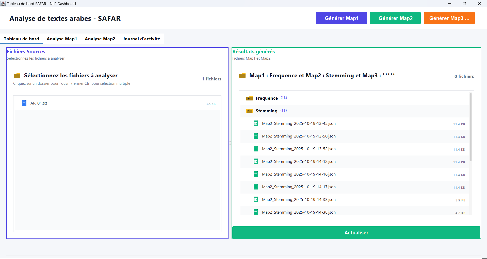
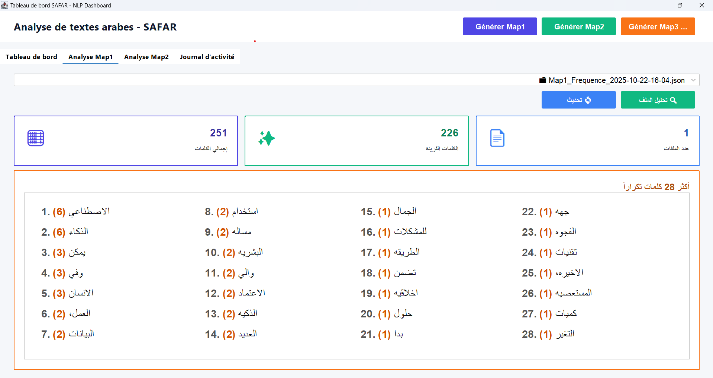
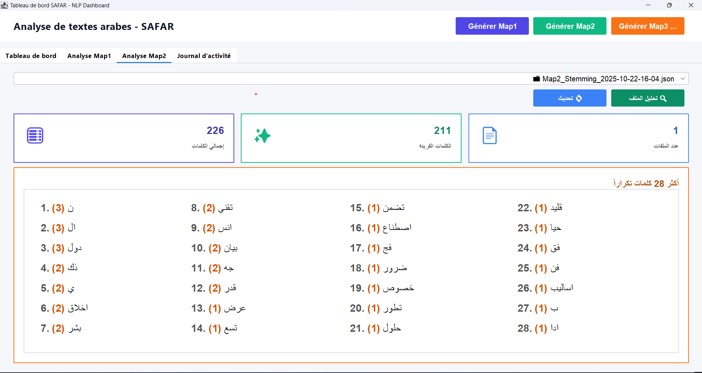

# My-Arabic-NLP-Server

A Java desktop application for analyzing Arabic text, generating frequency maps, and extracting word roots through a bilingual Arabic/French Swing interface.

## Features

| Feature | Description |
| --- | --- |
| Word-frequency analysis (Map 1) | Counts Arabic words found in selected text files |
| Root extraction (Map 2) | Applies SAFAR stemming rules to group words by root |
| Dashboard | Displays totals, unique-word counts, and the most frequent terms |
| Charts | Visualizes analysis results with JFreeChart |
| JSON output | Stores generated analyses as structured JSON files |
| Arabic interface | Supports right-to-left labels and Arabic fonts |

## Requirements

- Java Development Kit (JDK) 21
- Eclipse IDE or another Java IDE able to configure external JAR files
- The following libraries:
  - SAFAR v2
  - Gson 2.10.1
  - FlatLaf 3.6.2
  - FlatLaf Extras 3.4
  - JFreeChart 1.5.6

> [!IMPORTANT]
> The repository does not include these dependency JARs. The committed Eclipse `.classpath` currently references paths on the original developer's Windows computer, so those entries must be replaced with paths available on your machine.

## Setup and run

1. Clone the repository:

   ```bash
   git clone https://github.com/Jalal-Zerroudi/My-Arabic-NLP-Server.git
   cd My-Arabic-NLP-Server
   ```

2. Import the directory into Eclipse using **File → Import → Existing Projects into Workspace**.
3. Configure the project to use JDK 21.
4. Download or otherwise obtain the required libraries, respecting their respective licenses.
5. Open **Project → Properties → Java Build Path → Libraries** and replace the unavailable JAR entries with the local paths to your copies.
6. In **Run → Run Configurations → Arguments**, set the working directory to the repository root. The application uses relative paths for `src/data/`, `Map_Out/`, and the stop-word file.
7. Run `MainPackNLP.MainDashboardUI` as a Java application.

The application entry point is the `main` method in:

```text
src/MainPackNLP/MainDashboardUI.java
```

## Usage

1. Select one or more Arabic text files.
2. Generate **Map 1** to calculate word frequencies.
3. Generate **Map 2** to perform SAFAR-based stemming.
4. Review totals, unique words, top terms, and charts in the dashboard.
5. Consult the activity log for operation details.

> [!NOTE]
> **Map 3 is not implemented yet.** Its dashboard button only displays an informational message and does not generate an output file.

Generated results are stored under:

- `Map_Out/Frequence/` for frequency analyses
- `Map_Out/Stemming/` for stemming analyses

All text inputs, stop-word data, and generated JSON files are read and written explicitly as UTF-8, so Arabic content remains portable across operating systems.

### Generated files and Git

The repository's `.gitignore` excludes newly generated Map 1/Map 2 JSON files and Java build output under `bin/`. This keeps routine runs and local compilation from adding timestamped artifacts to future commits. Build the project locally to regenerate `bin/`; compiled classes and copied resources should not be committed.

### Which input does Map 2 use?

The **Generate Map 2** button automatically reads the `.json` file in
`Map_Out/Frequence/` with the latest filesystem modification time. It does
not use the currently selected source files or the JSON selected in an analysis
tab. Selection in an analysis tab only controls which result is displayed.

To stem your current inputs, generate Map 1 first and confirm its success in the
activity log, then generate Map 2 without copying or editing other frequency
JSON files in between. Copying or editing an older result can change its
modification time and make it the next Map 2 input. If no frequency JSON exists,
Map 2 logs a warning and returns without generating a result.

## How to interpret the results

Map 1 is a count of processed tokens, not a count of every word in the original document. In `MapGenerator.java`, preprocessing:

- replaces characters outside the Unicode Arabic block and whitespace with spaces;
- normalizes `إ/أ/آ/ا → ا`, `ى/ئ → ي`, `ؤ → و`, and `ة → ه`;
- removes the diacritics listed in `normalizeArabic`;
- discards empty tokens, tokens shorter than two characters, and normalized stop words from `src/data/AR_Stop_Words.json`.

Distinct spellings can therefore share one frequency entry. Map 2 adds the Map 1 frequencies when several words produce the same stem; it does not merely count distinct source spellings. If SAFAR throws an exception for a word, its normalized form is retained as the fallback key.

Each JSON output is keyed first by input file path, then by token or stem, with integer counts as values. A file that fails to read is logged and omitted from Map 1. If the stop-word file cannot be loaded, processing continues without stop-word filtering, so inspect the activity log before comparing results.

## Project structure

```text
My-Arabic-NLP-Server/
├── src/
│   ├── MainPackNLP/
│   │   ├── MainDashboardUI.java
│   │   ├── MapGenerator.java
│   │   ├── FileBrowserUI.java
│   │   └── safar_classes.java
│   └── data/
├── Map_Out/
│   ├── Frequence/
│   └── Stemming/
├── docs/
├── safar_classes_methods.json
├── .classpath
└── README.md
```

## UI preview

| Dashboard | Map Analysis 1 | Map Analysis 2 |
| --- | --- | --- |
|  |  |  |

## Troubleshooting

- **JAR cannot be resolved:** replace the absolute paths in the Eclipse build path with valid local paths.
- **Wrong Java version:** confirm that both the project compiler and installed JRE target Java 21.
- **Arabic text displays incorrectly:** verify that the input files use UTF-8 encoding and that an Arabic-capable font is installed.
- **No result file appears:** confirm that the application can write to the repository's `Map_Out` directories.

## License

No standalone license file is currently included in this repository. Confirm the applicable terms before redistributing or reusing the source code or third-party libraries.

## Author

**Jalal Zerroudi**  
Master's student in Big Data and Intelligent Systems  
FSDM — USMBA, Fez, Morocco  
[jalal.zerroudi@gmail.com](mailto:jalal.zerroudi@gmail.com) · [GitHub](https://github.com/Jalal-Zerroudi)
